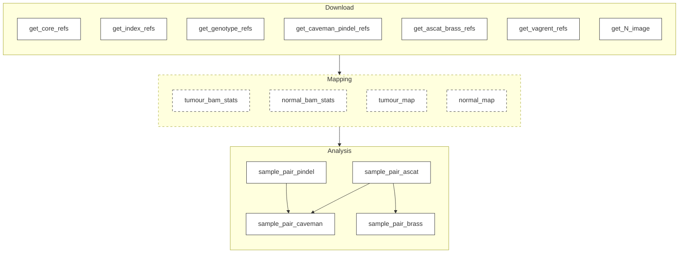

# sanger-wgs-gwf

[GWF](https://github.com/gwforg/gwf) workflows orchestrating the standard Sanger / [CGP](https://github.com/cancerit) WGS mapping and analysis tools.

Requires [singularity](https://sylabs.io/singularity) >= 3.11.0.

## Quickstart

### Installation
GWF and other Python dependencies can be installed with:
```sh
python3 -m venv .venv
. .venv/bin/activate
pip install -r requirements.txt
```

### Setup
Create an `input.csv` and `config.json`, which drive the pipeline
```sh
cp input.csv.template input.csv 
# Edit input.csv to point to input files 
cp config.json.lsf.template config.json
# Edit config.json to contain valid configuration
```

### Running
```sh
gwf status
# Confirm expected targets are generated before launching jobs:
gwf run
```

## Overview

This pipeline will run the standard CGP processing tools.



### Mapping

If `"mapping": true` is enabled in `config.json`, samples will be mapped using `bwa_mem.pl`.

Otherwise, if .bas files are not already present, `bam_stats` from pcap-core will run.

### Analysis

| Tool | Analysis type |
| - | - |
| ASCAT | CNVs |
| CaVEMan | SNVs |
| Pindel | Indels |
| BRASS | SVs |

# Acknowledgements

This repository is built directly on the GWF workflows used in the [PanProstate hg38 workflows](https://github.com/panprostate/panprostate_workflows) (currently a private repo), with significant contributions from Philippe Lamy and Gregory Leeman.
